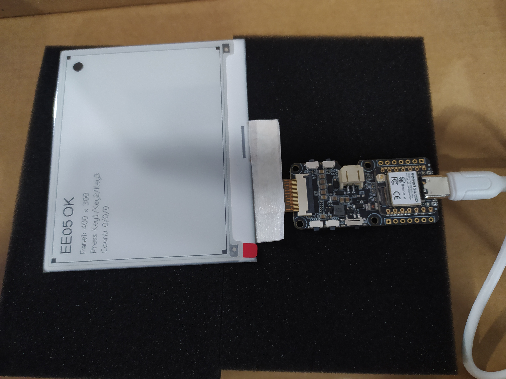

# Seeed Studio XIAO 4.2" ePaper Display Test

A PlatformIO project for testing a **4.2-inch ($400 \times 300$) ePaper display** paired with the **Seeed Studio XIAO ePaper Driver Board** and a **XIAO ESP32-S3** (or compatible XIAO microcontroller).

<p align="center">
  
</p>

## Overview

This firmware initializes the ePaper panel, verifies hardware communication (`EE05 OK`), and tracks button press events across the three onboard user keys (`Key1`, `Key2`, `Key3`) directly on the screen.

### Hardware Used
* **Microcontroller:** Seeed Studio XIAO ESP32-S3
* **Driver Board:** Seeed Studio XIAO ePaper Driver Board (EE05)
* **Display:** 4.2-inch Monochrome ePaper Panel ($400 \times 300$ resolution)

## Project Structure

```text
├── images/
│   └── epaper-testing.jpg  # Hardware setup preview image
├── src/
│   ├── driver.h            # ePaper display pin definitions and driver configuration
│   └── main.cpp            # Main application logic and button counter handling
├── platformio.ini          # PlatformIO environment and library dependencies
├── .gitignore              # Git ignore rules for build artifacts
└── README.md               # Project documentation
```

## Getting Started

### Prerequisites
* [Visual Studio Code](https://code.visualstudio.com/)
* [PlatformIO IDE Extension](https://platformio.org/install/ide?install=vscode)

### Installation & Flashing
1. Clone this repository:
   ```bash
   git clone https://github.com/yourusername/xiao-ee05-4.2-epaper.git
   cd xiao-ee05-4.2-epaper
   ```
2. Open the folder in VS Code with PlatformIO installed.
3. Connect your XIAO board via USB-C.
4. Build and upload the firmware using the PlatformIO toolbar or terminal:
   ```bash
   pio run --target upload
   ```

## Usage
Once flashed, the ePaper screen will refresh and display:
* **Status:** `EE05 OK`
* **Resolution:** `Panel: 400 x 300`
* **Interactive Counter:** `Count: 0/0/0` — Press `Key1`, `Key2`, or `Key3` on the driver board to increment the respective counter on the display.
